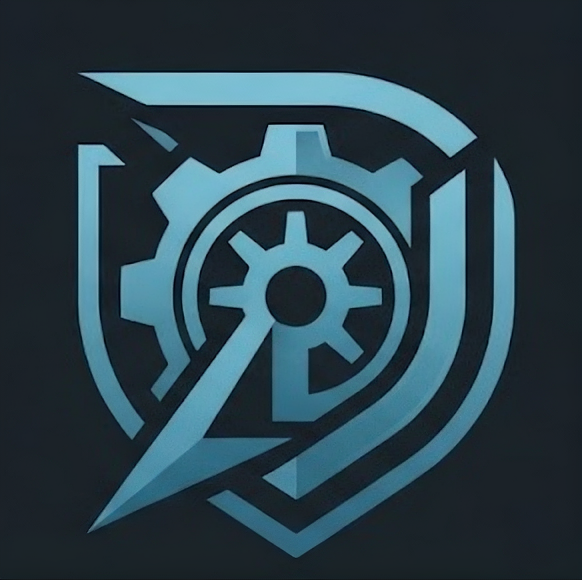
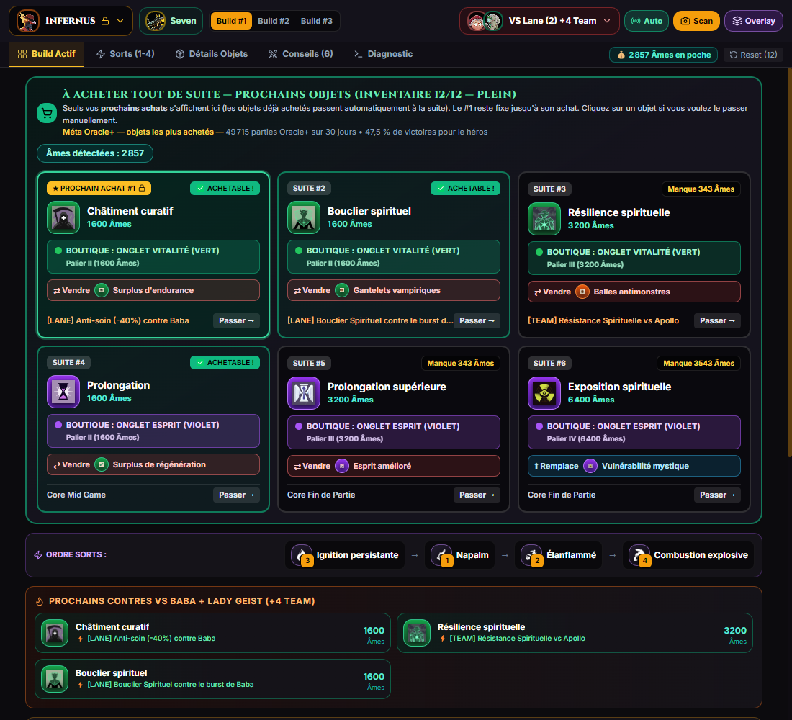
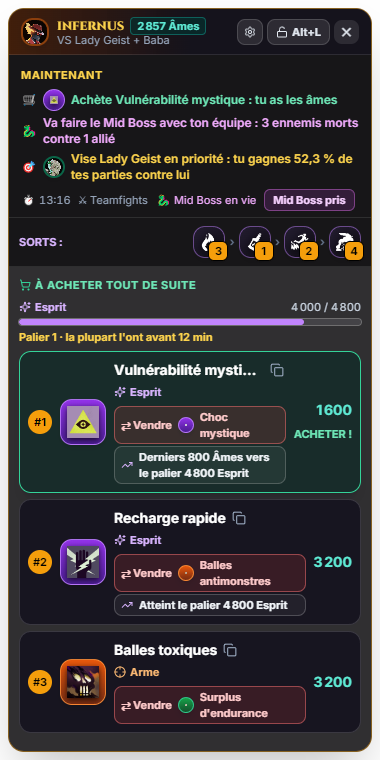

<div align="center">



# Deadlock Blueprint

**Ton coach de build en temps réel pour Deadlock.**
Il lit ton écran, reconnaît ta partie et te dit quoi acheter, maintenant.


[](https://github.com/PedroGomesFR/deadlock-blueprint/actions/workflows/ci.yml)

[**📥 Télécharger**](https://github.com/PedroGomesFR/deadlock-blueprint/releases/latest) · [Fonctionnalités](#-fonctionnalités) · [Peut-on être banni ?](#peut-on-être-banni-) · [FAQ](#-faq) · [Signaler un problème](#-signaler-un-problème) · [English](README.md)

</div>

---

<table>
  <tr>
    <td width="74%"></td>
    <td width="26%"></td>
  </tr>
  <tr>
    <td align="center"><sub>Fenêtre principale : prochains achats, contres et objet à vendre quand l'inventaire est plein</sub></td>
    <td align="center"><sub>Overlay par-dessus le jeu</sub></td>
  </tr>
</table>

## ✨ Fonctionnalités

### 👁️ Détection automatique, sans rien toucher au jeu
Toutes les 350 ms, l'application lit l'image de la fenêtre Deadlock et reconnaît :

- **Ton héros** grâce à ton portrait surligné dans la barre du haut (les 43 héros). Il est **verrouillé pour toute la partie** : quand tu es mort et que tu regardes un coéquipier, rien ne bouge.
- **Tes alliés, les 6 ennemis, ta lane et ton partenaire de lane**, que tu joues côté Ambre ou Saphir. Chaque portrait est voté sur toute la partie : une image mal lue (chrono de réapparition, bannière de PV critiques) ne change rien.
- **Ton inventaire** (12 slots, y compris ceux encore verrouillés), même boutique ouverte et objets en recharge.
- **Tes âmes**, lues par OCR, entièrement hors ligne.

### 🛒 Recommandations d'achat
- **Builds méta issus de vraies statistiques** : les objets les plus achetés en haut rang (Oracle+, 30 derniers jours) et le build publié avec le meilleur taux de victoire, via [deadlock-api.com](https://deadlock-api.com). **Mis à jour chaque semaine**, sans nouvelle version de l'application.
- **« À acheter tout de suite »** : les prochains objets dans l'ordre, avec l'onglet de la boutique et ce qu'il te manque en âmes. Le **#1 reste fixe** jusqu'à ce que tu l'achètes.
- **Pourquoi cet objet ?** « Acheté dans 76 % des parties Oracle+ d'Infernus · 47,8 % de victoires quand il est acheté · acheté vers 18:42 en moyenne », ou « Anti-soin contre Baba ».
- **Contres automatiques** contre tes adversaires de lane et l'équipe ennemie (anti-soin, résistances, immunité aux contrôles…).
- **Jamais un objet que tu as déjà**, ni un composant déjà amélioré.
- **Inventaire plein ?** Chaque recommandation indique **quel objet vendre** (le moins utile pour ton build), ou **lequel sera remplacé** s'il s'agit d'une amélioration.

- **Lisible d'un coup d'œil** : grandes icônes d'objets, l'onglet de la boutique par sa couleur et son icône, et un bouton qui **copie le nom de l'objet** pour le coller dans la recherche de la boutique (presse-papiers uniquement, rien n'est tapé dans le jeu).

### 🎯 Overlay en jeu
Un panneau transparent, toujours au premier plan, affiche ton ordre de sorts et tes 3 prochains achats. En **mode fantôme**, les clics le traversent et il ne gêne jamais ta visée.
Son bouton ⚙ règle son **opacité** (pour moins cacher la minicarte) et sa **taille** (100 / 85 / 70 %). Les boutons sont masqués en mode fantôme, puisque les clics vont au jeu : <kbd>Alt</kbd> + <kbd>L</kbd> les fait revenir.

### 🌍 Français, anglais, italien
L'interface et les guides des héros sont en français, en anglais et en italien. Les noms, descriptions et stats des objets et des sorts viennent des textes officiels du jeu dans chaque langue.

## 📥 Installation

À télécharger dans la [**dernière version**](https://github.com/PedroGomesFR/deadlock-blueprint/releases/latest) :

| Fichier | |
| :--- | :--- |
| `Deadlock-Blueprint-<version>.exe` | Portable : un seul fichier, sans installation. Te prévient quand une nouvelle version sort. |

> [!NOTE]
> L'exécutable n'est pas signé (un certificat coûte plusieurs centaines d'euros par an). Au premier lancement, Windows SmartScreen peut afficher « Windows a protégé votre ordinateur » : clique sur **Informations complémentaires**, puis sur **Exécuter quand même**.
> Chaque version est **compilée par GitHub Actions à partir du code source public** et liste le **SHA-256** du fichier avec un lien **VirusTotal**. Pour vérifier ton téléchargement : `Get-FileHash .\Deadlock-Blueprint-<version>.exe` dans PowerShell.

## Peut-on être banni ?

**L'application fonctionne comme OBS ou le partage d'écran de Discord : elle lit seulement l'image déjà affichée sur ton écran.**

- Elle **ne lit pas et n'écrit pas la mémoire du jeu**, n'**injecte** rien dans le jeu, ne **modifie** aucun fichier du jeu et n'**envoie aucune commande** (ni touche, ni souris).
- La capture passe par l'API standard de capture d'écran de Windows (celle qu'utilisent les navigateurs pour partager une fenêtre).
- L'overlay est une simple fenêtre au premier plan, comme l'overlay Discord ou Steam : il ne dessine pas dans le jeu.

Les anti-triche visent les programmes qui lisent ou modifient la mémoire d'un jeu, ou qui automatisent des actions : Deadlock Blueprint ne fait ni l'un ni l'autre et ne touche jamais au processus du jeu. Cela reste un outil tiers non approuvé par Valve, et personne d'autre que Valve ne peut rien garantir : à utiliser en connaissance de cause.

## 🔒 Vie privée

- **Aucune donnée de partie ne quitte ton PC.** Les seules requêtes réseau :
  - les builds et objets de la semaine, lus dans ce dépôt GitHub (`raw.githubusercontent.com`) ;
  - la recherche de mises à jour (versions GitHub) ;
  - les polices de l'interface (Google Fonts).
- **Les journaux de parties sont désactivés par défaut.** Si tu les actives (au premier lancement ou dans les Réglages), l'application garde un journal de tes 5 dernières parties **sur ton PC uniquement** (texte + captures du HUD : inventaire et barre du haut, ~30 Mo par partie), pour aider à corriger la détection. Ils sont rangés dans `%APPDATA%\deadlock-tactical-autobuild\match-logs` et se suppriment depuis les Réglages. Ils ne quittent ton PC que si tu les joins toi-même à un signalement.

## 🎮 Utilisation

1. Lance **Deadlock Blueprint**, puis Deadlock (l'ordre n'a pas d'importance).
2. Entre en partie : le héros, la lane, les ennemis et l'inventaire se remplissent tout seuls en 1 à 2 secondes.
3. Achète le **#1** affiché : il disparaît de la liste dès qu'il apparaît dans ton inventaire.

### 🖥️ Configurations prises en charge

| | |
| :--- | :--- |
| ✅ **16:9** : 1920×1080, 2560×1440, 3840×2160… | Calibré sur 1920×1080, les autres résolutions 16:9 y sont ramenées. |
| ✅ Plein écran ou fenêtré sans bordure | |
| 🧪 16:10, ultra-large (21:9, 32:9), 4:3, fenêtré avec bordures | Expérimental : le HUD est ramené à la disposition 16:9, pas encore vérifié sur de vraies captures de ces formats. Si la détection échoue, [signale un problème](#-signaler-un-problème) avec un journal de partie. |
| ⛔ Écran vertical, toute petite fenêtre | L'application le signale et **met la détection en pause** au lieu d'afficher de mauvaises recommandations. |
| ⚠️ Échelle du HUD modifiée, filtres de couleur | Le HUD n'est pas là où le scanner le cherche : l'application l'indique si elle ne trouve aucun HUD pendant plusieurs minutes. |

Un skin de héros dont le portrait est très différent du portrait par défaut peut être mal lu sur certaines images ; le vote sur la partie le retrouve en général.

### ⌨️ Raccourcis (utilisables en jeu)

| Raccourci | Action |
| :---: | :--- |
| <kbd>Alt</kbd> + <kbd>O</kbd> | Afficher / masquer l'**overlay** par-dessus le jeu |
| <kbd>Alt</kbd> + <kbd>L</kbd> | **Mode fantôme** : les clics traversent l'overlay |
| <kbd>Alt</kbd> + <kbd>S</kbd> | Forcer un scan immédiat |

### 🖱️ Corriger à la main
- **Clic sur ton héros** (en haut à gauche) : choisis-le dans la liste ; il est alors verrouillé pour la partie.
- **Clic sur un objet proposé** (« Passer ») : marque-le comme déjà acheté, utile si un objet de ton inventaire n'est pas reconnu.
- **Reset** : vide la liste des objets possédés.
- L'onglet **Diagnostic** montre ce que le scanner voit : capture, portraits slot par slot (★ = toi), inventaire slot par slot.

## 🐞 Signaler un problème

**Diagnostic › Signaler un problème** (ou les Réglages) crée un `.zip` dans ton dossier Téléchargements avec les infos système et, si tu veux, le journal de ta dernière partie, puis ouvre une page GitHub pré-remplie. **Glisse le `.zip` dans la page** avant d'envoyer. Avec un journal de partie, la partie peut être rejouée et le scanner corrigé : c'est ainsi que se corrigent la plupart des problèmes de détection.

## ❓ FAQ

<details>
<summary><b>Le héros détecté n'est pas le bon</b></summary>

Clique sur le héros en haut à gauche et choisis le bon : il est verrouillé pour la partie, puis re-détecté automatiquement à la partie suivante.
</details>

<details>
<summary><b>Rien n'est détecté</b></summary>

- Vérifie que la fenêtre du jeu s'appelle bien « Deadlock », qu'elle n'est pas réduite et que ton format d'écran est pris en charge (voir [Configurations prises en charge](#%EF%B8%8F-configurations-prises-en-charge)).
- Vérifie que **Auto** (à côté de Scan, en haut) est activé : il allume et éteint le scan automatique.
- La détection des héros a besoin de la barre du haut (scores des deux équipes). Les modes sans cette barre, comme l'entraînement, ne sont pas reconnus.
- L'onglet **Diagnostic** indique la source capturée et ce qui est reconnu.
</details>

<details>
<summary><b>Un objet que j'ai déjà est encore proposé</b></summary>

Son icône n'a pas été reconnue dans ton inventaire : l'application l'indique (« ⚠ objet non reconnu »). Clique sur l'objet proposé pour le passer.
</details>

<details>
<summary><b>Pourquoi a-t-elle besoin d'Internet ?</b></summary>

Seulement pour télécharger les builds de la semaine et vérifier les mises à jour. Sans Internet, elle fonctionne avec les builds qu'elle a déjà. Les âmes sont lues hors ligne.
</details>

<details>
<summary><b>Combien de RAM utilise l'application ?</b></summary>

Environ 650 Mo au total, stable dans le temps, dont environ 400 Mo pour le pipeline de capture vidéo (processus GPU).
</details>

## 🛠️ Développement

**Prérequis :** [Node.js](https://nodejs.org) 20 ou plus, Windows.

```bash
git clone https://github.com/PedroGomesFR/deadlock-blueprint.git
cd deadlock-blueprint
npm install
npm run dev
```

| Commande | Rôle |
| :--- | :--- |
| `npm run dev` | Interface avec rechargement à chaud (Vite) + Electron |
| `npm test` | Règles, parties enregistrées rejouées, traductions |
| `npm run test:vision` | Le vrai scanner sur des images de parties enregistrées (Electron) |
| `npm run dist` | Exécutable portable dans `release/` |
| `npm run update-builds` | Builds méta et catalogue d'objets depuis deadlock-api.com (fait chaque semaine par GitHub Actions) |

Voir [**docs/CONTRIBUTING.md**](docs/CONTRIBUTING.md) (en anglais) pour recalibrer le scanner, ajouter un héros, traduire ou publier une version. Les coordonnées du HUD et les choix de calibration sont dans [`AGENTS.md`](AGENTS.md).

**Stack :** Electron · React · TypeScript · Vite · Tailwind CSS · Tesseract.js

## ⚖️ Mentions légales

Projet de fan, **non affilié à Valve Corporation ni approuvé par elle**. Deadlock ainsi que ses noms, images et icônes de héros et d'objets sont la propriété de Valve ; le projet en inclut une partie pour reconnaître et afficher les héros et les objets. Données de jeu et statistiques : [deadlock-api.com](https://deadlock-api.com). Code source sous [licence MIT](LICENSE) ; voir [NOTICE.md](NOTICE.md) pour les contenus tiers.
