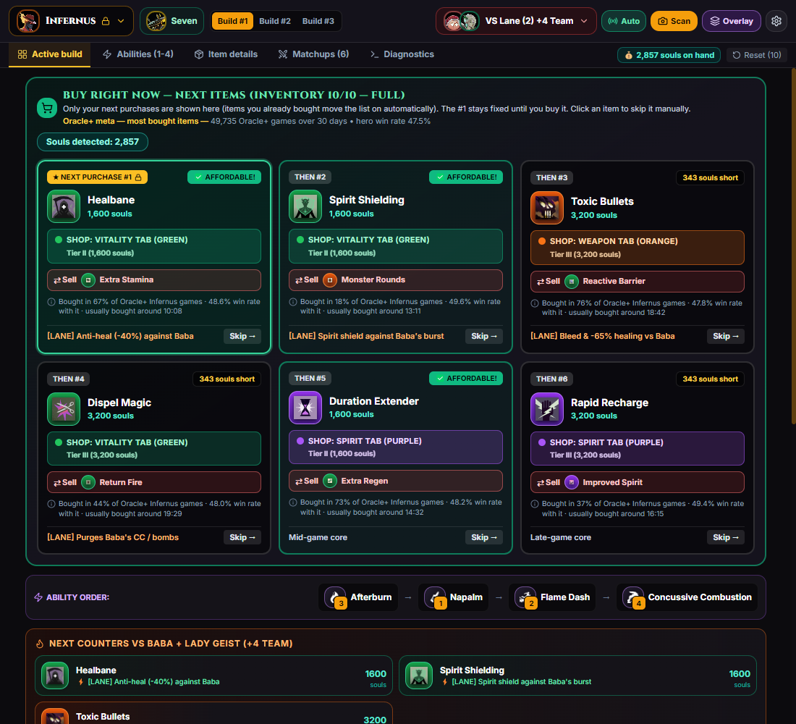
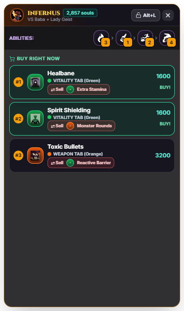

<div align="center">


# Deadlock Blueprint

**Your real-time build coach for Deadlock.**
It watches your screen, recognizes your match and tells you what to buy, right now.


[](https://github.com/PedroGomesFR/deadlock-blueprint/actions/workflows/ci.yml)

[**📥 Download**](https://github.com/PedroGomesFR/deadlock-blueprint/releases/latest) · [Features](#-features) · [Can I get banned?](#can-i-get-banned) · [FAQ](#-faq) · [Report a problem](#-report-a-problem) · [Français](README.fr.md)

</div>

---

<!-- TODO: docs/demo.gif — 15 s: buy the #1 in the shop, the list moves on (see docs/CONTRIBUTING.md › Recording the demo) -->

<table>
  <tr>
    <td width="74%"></td>
    <td width="26%"></td>
  </tr>
  <tr>
    <td align="center"><sub>Main window: next purchases, what to sell when your inventory is full, and why each item</sub></td>
    <td align="center"><sub>Overlay on top of the game</sub></td>
  </tr>
</table>

## ✨ Features

### 👁️ Automatic detection, without touching the game
Every 350 ms the app reads the image of the Deadlock window and recognizes:

- **Your hero**, from your highlighted portrait in the top bar (all 43 heroes). It stays **locked for the whole match**: when you are dead and spectating a teammate, nothing changes.
- **Your allies, the 6 enemies, your lane and your lane partner**, on the Amber or Sapphire side. Each portrait is voted over the whole match, so a single misread frame (a respawn timer, a low-HP banner) changes nothing.
- **Your inventory** (12 slots, padlocked ones included), even with the shop open and with items on cooldown.
- **Your souls**, read by OCR, fully offline.

### 🛒 What to buy
- **Meta builds from real statistics**: the items most bought by high-rank players (Oracle+, last 30 days) and the published build with the best win rate, from [deadlock-api.com](https://deadlock-api.com). **Updated every week**, without a new version of the app.
- **"Buy right now"**: your next items in order, with their shop tab and how many souls you are short. The **#1 stays fixed** until you buy it.
- **Why this item?** "Bought in 76% of Oracle+ Infernus games · 47.8% win rate with it · usually bought around 18:42", or "Anti-heal against Baba".
- **Counters** against your lane opponents and the enemy team (anti-heal, resists, CC immunity…).
- **Never an item you already own**, nor a component already upgraded.
- **Inventory full?** Each recommendation says **which item to sell** (the least useful for your build), or **which one it replaces** for an upgrade.

- **Readable at a glance**: big item icons, the shop tab as its colour and icon, and a button that **copies the item name** to paste into the shop search (clipboard only, nothing is typed into the game).

### 🎯 In-game overlay
A transparent panel, always on top, shows your ability order and your next 3 purchases. In **ghost mode** clicks go through it, so it never gets in the way of your aim.
Its ⚙ button sets its **opacity** (so it hides less of the minimap) and its **size** (100 / 85 / 70 %). The buttons are hidden in ghost mode, since clicks go through to the game: <kbd>Alt</kbd> + <kbd>L</kbd> brings them back.

### 🌍 English, French, Italian
The interface and the hero guides are in English, French and Italian. Item and ability names, descriptions and stats come from the game's official texts in each language.

## 📥 Installation

Download from the [**latest release**](https://github.com/PedroGomesFR/deadlock-blueprint/releases/latest):

| File | |
| :--- | :--- |
| `Deadlock-Blueprint-<version>.exe` | Portable: one file, no install. Tells you when a new version is out. |

> [!NOTE]
> The executable is not code-signed (a certificate costs several hundred euros a year). On first launch Windows SmartScreen may say "Windows protected your PC": click **More info**, then **Run anyway**.
> Each release is **built by GitHub Actions from the public source code** and lists the **SHA-256** of the file with a **VirusTotal** link. To check your download: `Get-FileHash .\Deadlock-Blueprint-<version>.exe` in PowerShell.

## Can I get banned?

**The app works like OBS or Discord screen sharing: it only reads the image that is already on your screen.**

- It does **not read or write the game's memory**, does **not inject** anything into the game, does **not modify** any game file and does **not send any input** (no keystrokes, no mouse).
- The capture uses the standard Windows screen-capture API (the same one browsers use to share a window).
- The overlay is an ordinary always-on-top window, like the Discord or Steam overlay, and does not draw inside the game.

Anti-cheat systems go after programs that read or modify a game's memory or automate input; Deadlock Blueprint does neither and never touches the game process. That said, it is a third-party tool that Valve has not approved, and nobody but Valve can promise anything: use it at your own discretion.

## 🔒 Privacy

- **No match data leaves your PC.** The only network requests are:
  - the weekly builds and items, read from this GitHub repository (`raw.githubusercontent.com`);
  - the update check (GitHub releases);
  - the interface fonts (Google Fonts).
- **Game logs are off by default.** If you turn them on (first launch, or Settings), the app keeps a log of your last 5 matches **on your PC only** (text plus HUD captures of the inventory and top bar, ~30 MB per match), to help fix detection problems. They are stored in `%APPDATA%\deadlock-tactical-autobuild\match-logs` and can be deleted from Settings. They only leave your PC if you attach them to a report yourself.

## 🎮 Usage

1. Start **Deadlock Blueprint**, then Deadlock (in any order).
2. Join a match: hero, lane, enemies and inventory fill in on their own within 1–2 seconds.
3. Buy the **#1**: it leaves the list as soon as it appears in your inventory.

### 🖥️ Supported setups

| | |
| :--- | :--- |
| ✅ **16:9**: 1920×1080, 2560×1440, 3840×2160… | Calibrated on 1920×1080; other 16:9 resolutions are scaled to it. |
| ✅ Fullscreen or borderless windowed | |
| 🧪 16:10, ultrawide (21:9, 32:9), 4:3, windowed with borders | Experimental: the HUD is mapped onto the 16:9 layout, not yet checked on real captures of these formats. If detection fails, [report a problem](#-report-a-problem) with a game log. |
| ⛔ Vertical screen, tiny window | The app says so and **pauses detection** instead of showing wrong recommendations. |
| ⚠️ A changed HUD scale, colour filters | The HUD is not where the scanner looks: the app shows a hint when it finds no HUD for a few minutes. |

Hero skins whose portrait differs a lot from the default one may be misread on some frames; the per-match vote usually recovers them.

### ⌨️ Shortcuts (they work in game)

| Shortcut | Action |
| :---: | :--- |
| <kbd>Alt</kbd> + <kbd>O</kbd> | Show / hide the **overlay** on top of the game |
| <kbd>Alt</kbd> + <kbd>L</kbd> | **Ghost mode**: clicks go through the overlay |
| <kbd>Alt</kbd> + <kbd>S</kbd> | Scan now |

### 🖱️ Fixing things by hand
- **Click your hero** (top left) and pick the right one: it is then locked for the match.
- **Click a suggested item** ("Skip") to mark it as bought, useful if an item of your inventory is not recognized.
- **Reset** clears the owned items.
- The **Diagnostics** tab shows what the scanner sees: capture, portraits slot by slot (★ = you), inventory slot by slot.

## 🐞 Report a problem

**Diagnostics › Report a problem** (or Settings) creates a `.zip` in your Downloads folder with the system info and, if you want, the log of your last match, then opens a pre-filled GitHub issue. **Drag the `.zip` into the issue** before submitting. A game log lets the match be replayed and the scanner fixed: that is how most detection bugs get fixed.

## ❓ FAQ

<details>
<summary><b>The detected hero is wrong</b></summary>

Click the hero at the top left and pick the right one: it is locked for the match, then detected again automatically at the next match.
</details>

<details>
<summary><b>Nothing is detected</b></summary>

- Check that the game window is called "Deadlock" and is not minimized, and that your screen format is supported (see [Supported setups](#%EF%B8%8F-supported-setups)).
- Check that **Auto** (next to Scan, at the top) is on: it turns the automatic scan on and off.
- Hero detection needs the top bar (both teams' scores). Modes without it, such as the training range, are not recognized.
- The **Diagnostics** tab shows the captured source and what is recognized.
</details>

<details>
<summary><b>An item I already own is still suggested</b></summary>

Its icon was not recognized in your inventory: the app says so ("⚠ item not recognized"). Click the suggested item to skip it.
</details>

<details>
<summary><b>Why does it need the Internet?</b></summary>

Only to download the weekly builds and to check for updates. Without Internet it works with the builds it already has. Souls are read offline.
</details>

<details>
<summary><b>How much RAM does it use?</b></summary>

About 650 MB in total, stable over time, of which about 400 MB is the video capture pipeline (GPU process).
</details>

## 🛠️ Development

**Requirements:** [Node.js](https://nodejs.org) 20 or later, Windows.

```bash
git clone https://github.com/PedroGomesFR/deadlock-blueprint.git
cd deadlock-blueprint
npm install
npm run dev
```

| Command | |
| :--- | :--- |
| `npm run dev` | Interface with hot reload (Vite) + Electron |
| `npm test` | Rules, recorded games replayed through them, translations |
| `npm run test:vision` | The real scanner on saved game frames (Electron) |
| `npm run dist` | Portable exe in `release/` |
| `npm run update-builds` | New meta builds and item catalogue from deadlock-api.com (done every week by GitHub Actions) |

See [**docs/CONTRIBUTING.md**](docs/CONTRIBUTING.md) to recalibrate the scanner, add a hero, translate, or publish a release. The HUD coordinates and calibration notes are in [`AGENTS.md`](AGENTS.md).

**Stack:** Electron · React · TypeScript · Vite · Tailwind CSS · Tesseract.js

## ⚖️ Legal

Deadlock Blueprint is a fan project, **not affiliated with, endorsed or approved by Valve Corporation**. Deadlock and its names, images, hero and item icons are the property of Valve; the project includes some of them to recognize and show heroes and items. Game data and statistics come from [deadlock-api.com](https://deadlock-api.com). The source code is under the [MIT licence](LICENSE); see [NOTICE.md](NOTICE.md) for third-party content.
